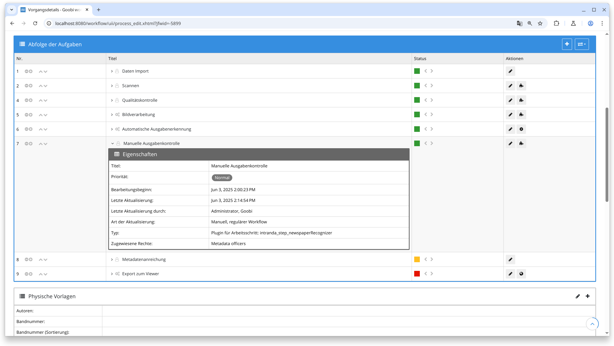
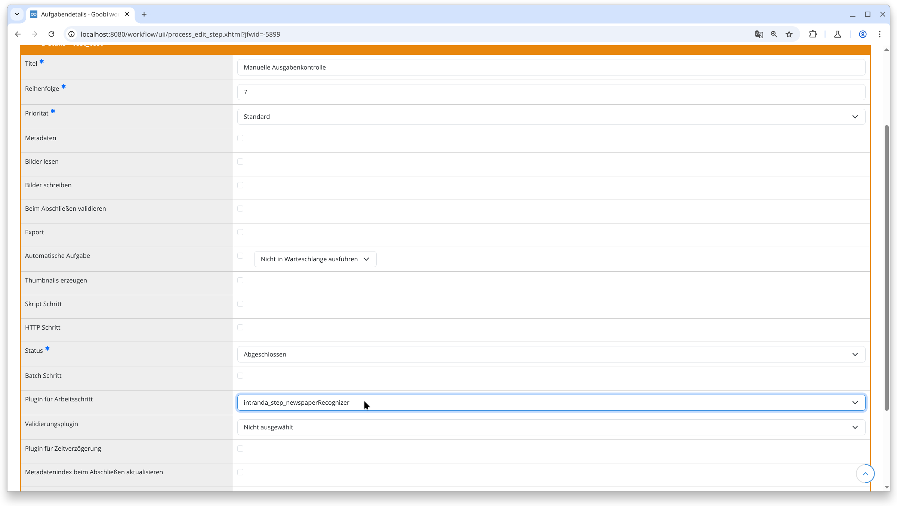
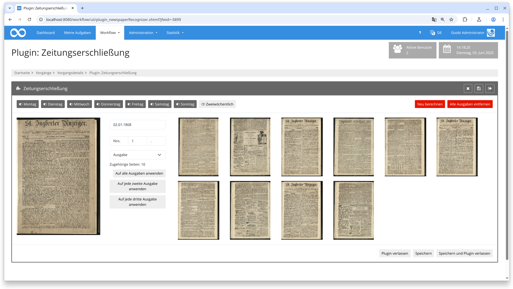
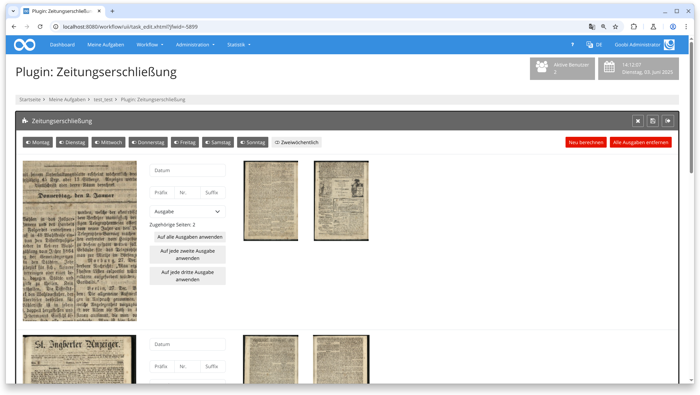
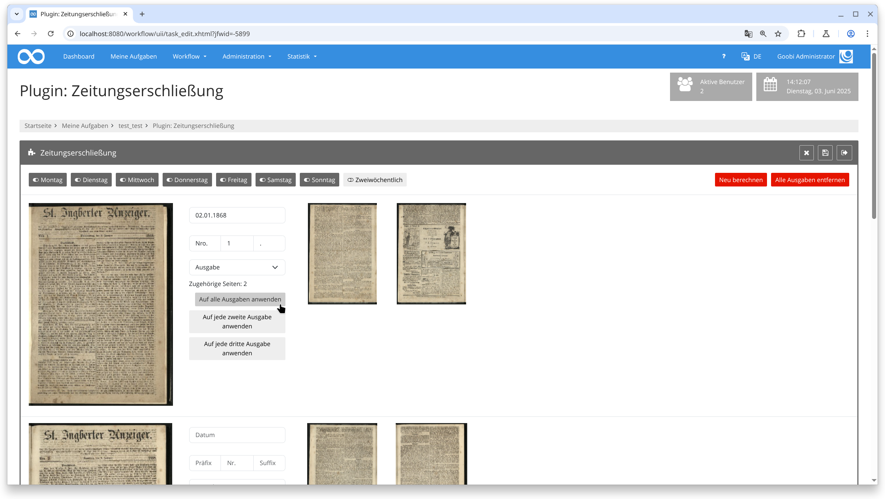
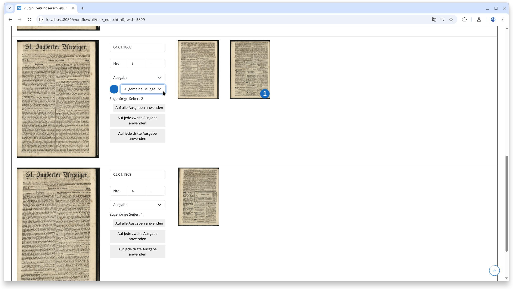

## Einführung
Diese Dokumentation erläutert das Plugin zur manuellen Ausgabenkontrolle. Dieses Step-Plugin für Goobi workflow ermöglicht es Nutzern, METS-Dateien für Zeitungsbände anzureichern, so dass bequem Datums- und Ausgaben-Informationen für zahlreiche Ausgaben innerhalb eines Bandes definiert werden können. Das Plugin erstellt automatisch Strukturelemente für jede Zeitungsausgabe zusammen mit Metadaten in standardisierten und benutzerfreundlichen Formaten sowie mit Paginierungsinformationen.

## Installation
Um das Plugin nutzen zu können, müssen folgende Dateien installiert werden:

```bash
/opt/digiverso/goobi/plugins/step/plugin-step-olr-newspaper-recognizer-base.jar
/opt/digiverso/goobi/plugins/GUI/plugin-step-olr-newspaper-recognizer-gui.jar
/opt/digiverso/goobi/config/plugin_intranda_step_newspaperRecognizer.xml
```

Nach der Installation des Plugins kann dieses innerhalb des Workflows für die jeweiligen Arbeitsschritte ausgewählt und somit automatisch ausgeführt werden. Ein Workflow könnte dabei beispielhaft wie folgt aussehen:



Für die Verwendung des Plugins muss dieses in einem Arbeitsschritt ausgewählt sein:




## Überblick und Funktionsweise

Das Plugin zeigt die Bilder eines Bandes als Blöcke. Jeder Block ist eine Struktur des Bandes (zum Beispiel eine Ausgabe oder ein Inhaltsverzeichnis), deren Typ aus dem Regelsatz stammt. Beim Öffnen liest das Plugin die Strukturen, die bereits in der METS-Datei vorhanden sind. Ein Band ohne Struktur beginnt mit den Blöcken der automatischen Analyse; ihr Typ steht noch auf „— bitte wählen —“.



Ein Klick auf eine Seite beginnt dort einen neuen Block; ein Klick auf die erste Seite eines Blocks entfernt ihn, seine Seiten gehören dann zum vorherigen Block. Ein Klick mit `STRG` oder `ALT` beginnt einen Unterblock (zum Beispiel eine Beilage) innerhalb eines Blocks, der bis zum Ende des Blocks oder bis zum nächsten Unterblock reicht; auf der ersten Seite eines Unterblocks entfernt er ihn, auf einer späteren Seite teilt er ihn; diese Seiten werden mit einer farbigen Ziffer markiert. Mit gedrückter `SHIFT`-Taste wird eine Seite beim Überfahren vergrößert.

Das Auswahlmenü eines Blocks bietet genau die Typen an, die der Regelsatz an dieser Stelle erlaubt, mit ihren Bezeichnungen aus dem Regelsatz. Ein Datumsfeld erscheint, wenn der Typ das konfigurierte Datumsmetadatum erlaubt, ein Nummernfeld (mit Präfix und Suffix, falls konfiguriert), wenn er das Nummernmetadatum erlaubt. Darunter folgen die konfigurierten Metadatenfelder des Typs, zum Beispiel der Titel. Ein Feld mit generiertem Wert zeigt diesen Wert an und aktualisiert ihn, während sich Datum und Nummer ändern; er kann überschrieben werden. Ein überschriebener Wert ist hervorgehoben und hat im Feld eine Schaltfläche, die den generierten Wert wiederherstellt. Ändert sich der generierte Wert danach, etwa weil die Nummer geändert wurde, bekommt diese Schaltfläche einen Punkt; ein Klick zeigt den neuen Wert, der übernommen oder verworfen werden kann. Das gilt nur für Änderungen seit dem Öffnen des Plugins. Ändert sich der Typ eines Blocks, bleiben Werte aus Feldern, die der neue Typ nicht anzeigt, als zusätzliche Daten erhalten; Werte, die der neue Typ nicht erlaubt, werden im Dialog zur Typänderung aufgeführt. Pflichtwerte sind mit `*` markiert. Gespeichert werden kann erst, wenn jeder Block einen Typ hat, alle Pflichtwerte gefüllt und alle Datumsangaben gültig sind und – falls konfiguriert – keine Duplikate vorliegen.



Zwei Werkzeuge füllen viele Blöcke auf einmal:

- **Typmuster anwenden** setzt die Typen eines Blocks und aller folgenden Blöcke derselben Ebene nach einem sich wiederholenden Muster, zum Beispiel Morgenausgabe, Abendausgabe. Datum und Nummer bleiben erhalten, wo der neue Typ diese Felder hat.
- **Ab hier fortsetzen** füllt Datum und Nummer ab einem Block. Berücksichtigt werden nur die gewählten Typen. Ein neuer Tag beginnt entweder, sobald sich ein berücksichtigter Typ wiederholt, oder mit jedem berücksichtigten Block (Option „neues Datum für jede Ausgabe“). Die Nummer zählt pro Tag (Morgen 1, Abend 1, Morgen 2 …) oder pro Ausgabe (Morgen 1, Abend 2, Morgen 3 …); bei „neues Datum für jede Ausgabe“ ist beides gleich, die Einstellung ist dann gesperrt (außer ein berücksichtigter Typ hat eine Nummer, aber kein Datum). Die Erscheinungstage (einzeln wählbar oder per Schnellwahl täglich, Mo–Sa, Mo–Fr) und ein zweiwöchentlicher Rhythmus steuern das Datum. Die Vorschau listet die folgenden Blöcke nach Erscheinungstag; ein geänderter Wert steht hervorgehoben, der bisherige klein und durchgestrichen darüber. Nicht berücksichtigte Blöcke sind grau, ein Symbol nennt den Grund. „Unveränderte ausblenden“ blendet Blöcke aus, deren Werte gleich bleiben; übernommen werden nur Blöcke, die sich ändern. Typen werden nie geändert.



Strukturen und Metadaten, die das Plugin nicht verwaltet – zum Beispiel Artikel unterhalb einer Beilage oder eine im Metadateneditor ergänzte Notiz – bleiben erhalten. Ein Hinweis neben dem Block zeigt ihre Anzahl; ein Klick listet sie auf. Würde eine Änderung sie betreffen (Block entfernen, Typ oder Seiten ändern), fragt das Plugin, was mit ihnen geschehen soll. Beim Speichern gehen sie nie unbemerkt verloren.



Jede Seite zeigt ihre Seitenbezeichnung unter der Vorschau; sie kann dort bearbeitet werden. Beim Tippen zeigt das Plugin, was erkannt wurde und welche der folgenden Seiten mitzählen; `Enter` übernimmt die Bezeichnung. Die Regeln, nach denen Blöcke paginiert werden (erste Bezeichnung je Typ, Seiten ohne Block), werden im Dialog „Paginierung …“ im Aktionsmenü oder mit dem Button in einem Block der obersten Ebene bearbeitet; eine Vorschau zeigt vor dem Übernehmen, was sich ändert. Der Dialog listet die Regeln aus der Plugin-Konfiguration und darunter die in dieser Sitzung angelegten; weitere Typen kommen über „Regel hinzufügen“ dazu. Konfigurierte Regeln lassen sich für die Sitzung ändern oder entfernen und einzeln oder mit „Konfigurierte Regeln zurücksetzen“ wiederherstellen; die Konfigurationsdatei bleibt unverändert. Ein Hinweis am oberen Rand macht auf Seiten ohne Paginierung im METS aufmerksam (sie lassen sich nach den Regeln erzeugen) und auf Seiten, die seit dem Öffnen geändert wurden (ihre Paginierung lässt sich aus dem METS wiederherstellen).

Beim Speichern wird die METS-Datei angepasst: neue Blöcke werden ergänzt, entfernte gelöscht, geänderte behalten alles, was das Plugin nicht verwaltet.

### Durch den ganzen Band zählen

Standardmäßig beginnt jeder Block der obersten Ebene seine Zählung neu. Mit der Auswahl „Zählung“ = „durch den ganzen Band zählen“ im Regeldialog (Vorgabe über `countThroughVolume="true"` an `pagination`) teilen sich alle Blöcke der obersten Ebene, für deren Typ eine Regel gilt, einen gemeinsamen Zählstrom in Seitenreihenfolge: `… 7 8 | 9 10 …`. Unterblöcke behalten ihre eigene Zählung. Seiten ohne Block behalten ihren eigenen Strom; die Bandzählung überspringt sie und setzt danach fort, ebenso Blöcke der obersten Ebene ohne Regel.

Ein nicht zählender erster Wert wie `–` bei `beginsWith = "– 1"` gilt in jedem Block (`… 7 8 | – 9 10 …`); ein zählender Startwert gilt nur im ersten Block, spätere Blöcke zählen ab dem letzten zählenden Wert davor weiter. Haben Typen der obersten Ebene unterschiedliche Regeln (zum Beispiel einer `1`, ein anderer `i`), wird der zählende Wert der Regel eines späteren Blocks nicht verwendet: der Block setzt den Strom fort.

Bei automatischer Paginierung paginiert eine Strukturänderung nur bis zum Ende des geänderten Blocks. Spätere Blöcke, deren Bezeichnungen die Bandzählung ändern würde, werden in einem Hinweis angeboten, der alle Angebote auf einmal übernimmt.

## Konfiguration
Die Konfiguration des Plugins erfolgt in der Datei `plugin_intranda_step_newspaperRecognizer.xml` wie hier aufgezeigt:

{{CONFIG_CONTENT}}

{{CONFIG_DESCRIPTION_PROJECT_STEP}}

Parameter               | Erläuterung
------------------------|------------------------------------
`loadAllImages`         | Ob beim Start des Plugins alle Bilder geladen werden.
`showDeletePageButton`  | Ob Bilder im Plugin dauerhaft gelöscht werden können.
`preventDuplicates`     | Bei `true` ist das Speichern gesperrt, solange zwei Blöcke mit demselben Elternelement denselben Typ, dasselbe Datum und dieselbe Nummer haben.
`pagination`            | Paginierung der Seiten. `enabled` (Standard `true`): bei `false` zeigt das Plugin keine Seitenbezeichnungen und ändert eine vorhandene Paginierung nie. `automatic` (Standard `true`): Vorgabe, ob Blöcke bei jeder Strukturänderung nach den Regeln paginiert werden; im Regeldialog umschaltbar. `countThroughVolume` (Standard `false`): Vorgabe der Dialogauswahl „Zählung“ (in jedem Block neu beginnen / durch den ganzen Band zählen), siehe „Durch den ganzen Band zählen“. Ohne das Element gelten alle Standardwerte.
`withoutBlock`          | In `pagination`: `beginsWith` ist die erste Bezeichnung der Seiten außerhalb von Blöcken (Standard `–`, unpaginiert).
`rule`                  | In `pagination`: Regel für den Regelsatztyp `docstruct`. `beginsWith`: erste Bezeichnung eines Blocks dieses Typs, ein oder mehrere durch Leerzeichen getrennte Werte, zum Beispiel `1`, `i`, `I`, `[1]` (fiktiv), `–` (unpaginiert) oder `– 1`. `continueInParent` (Standard `false`): Unterblöcke dieses Typs im selben Elternblock zählen einander fort. Ein Typ ohne Regel: Typen, die der Regelsatz nur auf oberster Ebene erlaubt, beginnen mit `1`; Typen, die als Unterblock erlaubt sind, behalten die Zählung ihres Elternblocks. Unbekannte Typen, doppelte Regeln und ein leeres `beginsWith` sind Konfigurationsfehler. Die früheren `createNewPagination`, `type` und `useFakePagination` werden nicht mehr unterstützt und als Konfigurationsfehler gemeldet.
`defaults`              | Die Felder aller Typen, deren Regelsatz das Metadatum des Feldes erlaubt, auf jeder Ebene (auch in Unterblöcken).
`type`                  | Felder für den Regelsatztyp `docstruct`. Ein Feld mit demselben `key` wie ein Standardfeld ersetzt es an seiner Stelle; weitere Felder folgen nach den Standardfeldern.
`field`                 | `key`: das Metadatum. `role="date"` / `role="number"` (nur in `defaults`, je höchstens einmal): das Datums- bzw. Nummernfeld eines Blocks. Beim Datumsfeld ist `format` das Eingabeformat im Plugin (Standard `dd.MM.yyyy`) und `storeFormat` das Format des gespeicherten Werts (Standard `yyyy-MM-dd`); beim Nummernfeld ist `partKey` das Metadatum für Präfix + Nummer + Suffix (ohne es gibt es keine Präfix- und Suffixfelder). Ohne `value` ist das Feld ein Eingabefeld. `value` erzeugt den angezeigten Wert, der überschrieben werden kann. `hidden="true"` erzeugt den Wert bei jedem Speichern, ohne ihn anzuzeigen (erfordert `value`). Platzhalter: `{date:FORMAT}`, `{no}`, `{partNo}`, `{label}` (eigener Wert oder der des nächsten umschließenden Blocks), `{parent.date:FORMAT}`, `{parent.no}`, `{parent.partNo}`, `{parent.label}` (nur das direkte Elternelement). Ein leerer Platzhalter schreibt `[MISSING]`, mit `skipIfEmpty="true"` gar nichts. Sichtbare Felder unterstützen die Datumszeichen `d`, `dd`, `M`, `MM`, `yy`, `yyyy` und Text in einfachen Anführungszeichen.

Typen, Bezeichnungen, die erlaubte Hierarchie und Pflichtmetadaten werden aus dem Regelsatz gelesen. Die Bezeichnungen der Felder stammen aus dem Regelsatz, ihre Eingabeart aus der `goobi_metadataDisplayRules.xml` des Projekts des Vorgangs: unterstützt werden `input`, `textarea`, `readonly` und `select1`, jede andere Art wird als `input` angezeigt. Ein `select1`-Feld kann keinen `value` haben. Varianten wie Morgen- und Abendausgaben sind eigene Strukturtypen im Regelsatz; beide können als METS-Typ `issue` exportiert werden. Die Konfiguration wird beim Start des Plugins geprüft; Fehler werden im Plugin angezeigt, und das Speichern ist gesperrt, bis sie behoben sind.
