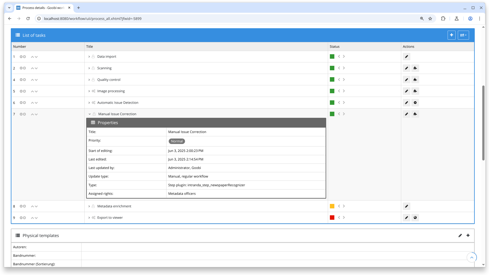
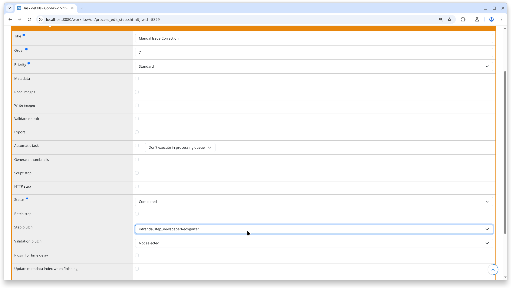
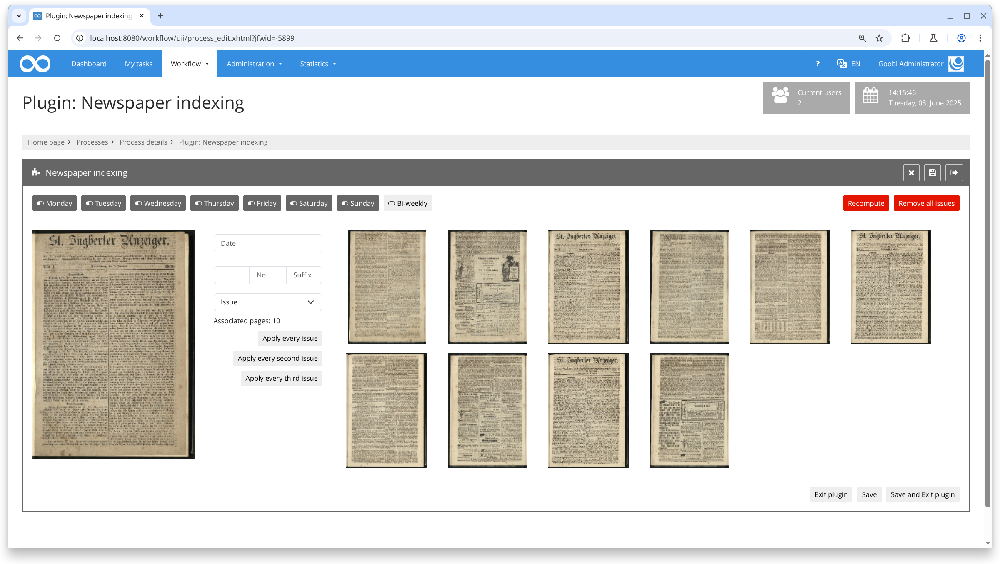
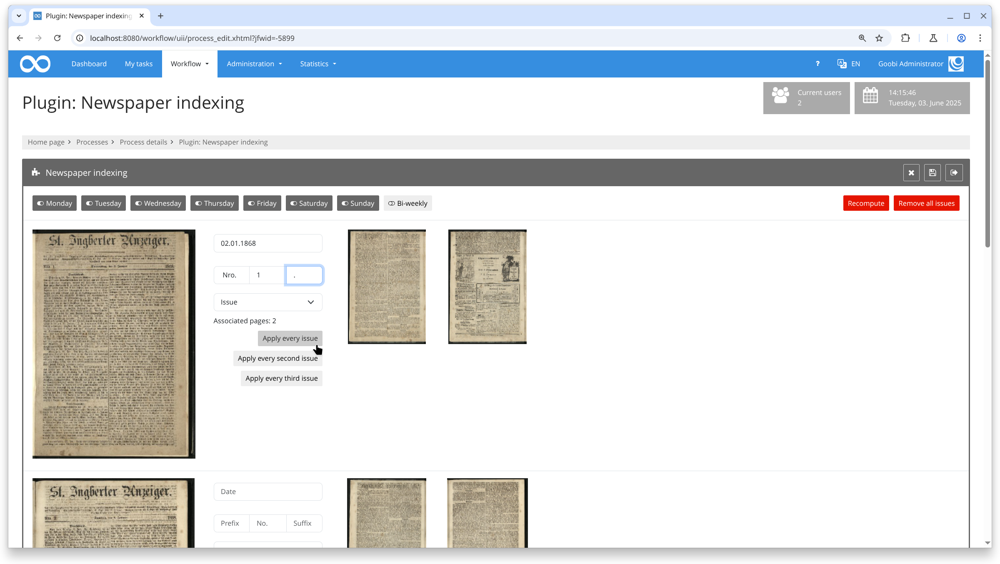
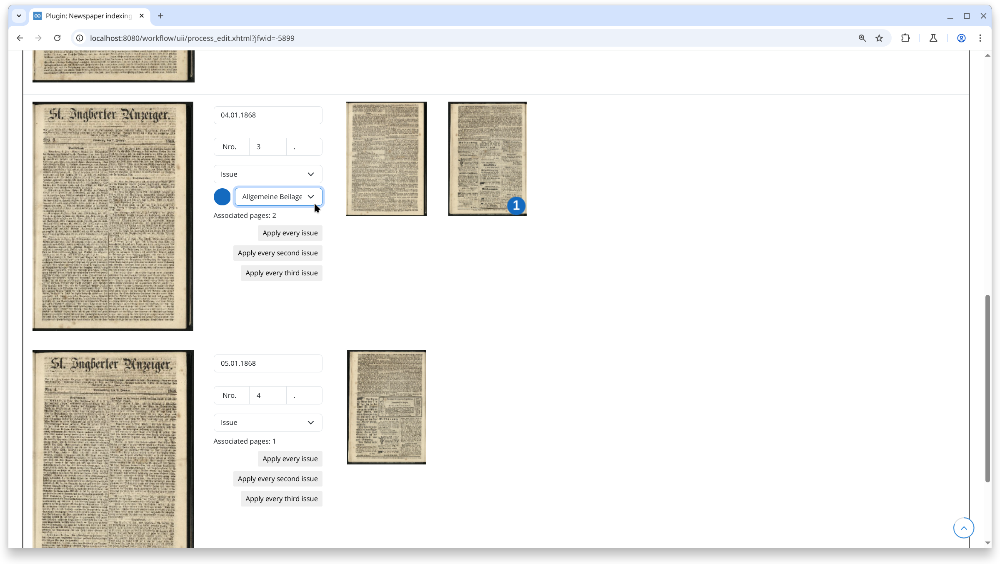

## Introduction

This documentation explains the plugin for manual issue control. This step plugin for Goobi workflow allows users to enrich METS files for newspaper volumes, enabling convenient definition of date and issue information for numerous issues within a volume. The plugin automatically creates structural elements for each newspaper issue along with metadata in standardized and user-friendly formats, including pagination information.

## Installation

To use the plugin, the following files need to be installed:

```bash
/opt/digiverso/goobi/plugins/step/plugin-step-olr-newspaper-recognizer-base.jar
/opt/digiverso/goobi/plugins/GUI/plugin-step-olr-newspaper-recognizer-gui.jar
/opt/digiverso/goobi/config/plugin_intranda_step_newspaperRecognizer.xml
```

After installing the plugin, it can be selected within the workflow for respective operations and executed automatically. A sample workflow setup could look like this:



To use the plugin, it must be selected in a workflow step:



## Overview and Functionality

The plugin shows the images of a volume as blocks. Each block is a structure of the volume (for example an issue or a table of contents) whose type comes from the ruleset. When the plugin is opened, it reads the structures that already exist in the METS file. A volume without structure starts with the blocks found by the automatic analysis; their type is still "— please select —".



A click on a page starts a new block there; a click on the first page of a block removes it, and its pages join the previous block. A click with `CTRL` or `ALT` starts a child block (for example a supplement) inside a block; such pages are marked with a coloured number. Hovering over a page while holding `SHIFT` enlarges it.

The drop-down of a block offers exactly the types the ruleset allows at that position, with their labels from the ruleset. A date field appears if the type allows the configured date metadata, a number field (with prefix and suffix, if configured) if it allows the number metadata. Required values are marked with `*`. The plugin cannot be saved while a block has no type, a required value is missing, a date is invalid or — if configured — two blocks are duplicates.


Two tools fill many blocks at once:

- **Apply type pattern** sets the types of a block and all following blocks on the same level in a repeating pattern, for example morning issue, evening issue. Date and number are kept where the new type has these fields.
- **Continue from here** fills in dates and numbers from a block onwards. Only the selected types are included. A new day starts either as soon as an included type repeats, or with every included block (option "new date for every issue"). Numbers count per day (morning 1, evening 1, morning 2 …) or per issue (morning 1, evening 2, morning 3 …). Weekdays and a biweekly rhythm control the dates. A preview shows the result before it is applied. Types are never changed.



Structures and metadata that the plugin does not manage – for example articles below a supplement or a note added in the metadata editor – are kept. A badge next to the block shows how many there are; a click lists them. If a change would affect them (removing the block, changing its type or its pages), the plugin asks what to do with them. Saving never drops them silently.



Saving updates the METS file in place: new blocks are added, removed blocks are deleted, changed blocks keep everything the plugin does not manage.

## Configuration

Plugin configuration is done in the file `plugin_intranda_step_newspaperRecognizer.xml` as shown here:

{{CONFIG_CONTENT}}

{{CONFIG_DESCRIPTION_PROJECT_STEP}}

Parameter               | Explanation
------------------------|------------------------------------
`loadAllImages`         | Whether all images are loaded when the plugin starts.
`showDeletePageButton`  | Whether images can be deleted permanently within the plugin.
`preventDuplicates`     | If `true`, saving is blocked while two blocks with the same parent have the same type, date and number.
`pagination`            | `createNewPagination` controls whether a new pagination is created (counted within each block). `type`: `1` Arabic, `i` Roman, `I` upper-case Roman, `-` none. `useFakePagination` writes `[N]`.
`fields/date`           | `metadata`: the metadata written from the date field; types that do not allow it have no date field. `format`: input format in the plugin (default `dd.MM.yyyy`). `storeFormat`: format of the stored value (default `yyyy-MM-dd`).
`fields/number`         | `metadata`: the metadata written from the number field. `partMetadata`: the metadata for prefix + number + suffix; without it there are no prefix and suffix fields.
`generate`              | Additional metadata for blocks of the ruleset type `docstruct`. Each `metadata` has a `key` (allowed for that type), a `value` with optional placeholders and optionally `skipIfEmpty="true"`. Placeholders: `{date:FORMAT}`, `{no}`, `{partNo}`, `{label}` (own value or that of the nearest enclosing block), `{parent.date:FORMAT}`, `{parent.no}`, `{parent.partNo}`, `{parent.label}` (direct parent only). An empty placeholder writes `[MISSING]`, or nothing with `skipIfEmpty`.

Types, labels, the allowed hierarchy and required metadata are read from the ruleset. Variants such as morning and evening issues are separate structure types in the ruleset; both can be exported as METS type `issue`. The configuration is checked when the plugin starts; errors are shown in the plugin and saving is disabled until they are fixed.
